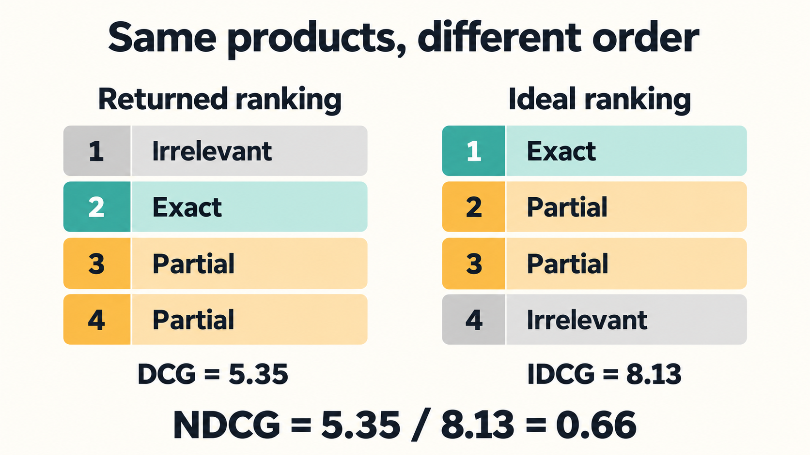

Since 2025 I have been working on search systems. Such systems are exciting and challenging at the same time: they are broad and require you to have a good UX, a solid data foundation, strong knowledge about different storages and APIs, and an infinite hunger for experiments. That's the reason why it's time to write my experiences down. I don't write books and I also think a blog post series, generated podcasts and an interactive app to explore search are the better format. I am going to write about 12 essentials and improvements where we use a well-known dataset and we move from a poor man's recency search to a well-graded sophisticated search that leverages many advanced techniques.

## The very first step: Write down what a good result means

No matter what, always start with the most important groundwork: define a set of queries and manually (or with the help of an LLM) decide what results for a given query are relevant. Additional context is helpful. There is no single truth for ambiguous queries like "Golf". Hence add some more information describing the user intent and the persona. The more detailed and comprehensive your test dataset is, the better your test results can translate into production. Testing your search system against a curated set of queries and judged results is what search experts call offline evaluation, and it's especially powerful because it allows your AI agents to refine the search until metrics are promising.

In this blog series I utilize a well-known dataset called **WANDS**, Wayfair's open product-search dataset[^1]. It contains 42,994 products, 480 queries and 233,448 relevance labels. The example search app evaluates a selected set of 246 queries. Each judged query-product pair has one of three labels: Exact, Partial or Irrelevant.

For the calculation, you can represent Exact as grade 3, Partial as grade 1 and Irrelevant as grade 0.

With this mapping, I am choosing to give an Exact result much more weight than a Partial result. For your search system, choose a mapping that reflects how useful these results are to your users.

When you build your test dataset, include relevant products that the ranker misses. If you judge only what it returns, a system could look perfect by finding one good result and missing all the others.

## Score the first ten results

If you listen to any search-related conference talk, you will hear about **NDCG@10**, normalized discounted cumulative gain at ten[^3]. It measures the quality of the first ten results against the best possible top ten from the query's judgments. If your product benefits from looking at more results or using different weights, adjust the metric to reflect what your users need.

Let me do the grading "on paper". Start with the grade. Convert it to a gain using `2^grade - 1`. Exact becomes 7, Partial becomes 1 and Irrelevant becomes 0[^2]. This gives us a number to add, but position still matters. An Exact result at rank one should count for more than the same result at rank ten.

Discount each gain by dividing it by `log2(rank + 1)`, where `log2` is the base-two logarithm. Rank one keeps its full gain. Rank two keeps about 0.63 of it, rank three keeps 0.5 and rank four keeps about 0.43. Add the discounted gains in the first ten positions. That is discounted cumulative gain, or DCG@10.

Next, sort **all judged products for the query** by grade and calculate DCG for the best ten. This is the ideal DCG, or IDCG. Divide the actual DCG by IDCG to get NDCG. The app returns 0 when IDCG is zero.

A small example makes the calculation easier to follow. We will use four products instead of ten to keep the arithmetic short: one Exact, two Partial and one Irrelevant. The ranker returns them in this order: Irrelevant, Exact, Partial, Partial.

We can lay out the returned ranking and calculate each contribution:

```text
Rank  Label       Grade  Gain  Discounted gain
1     Irrelevant    0      0   0 / log2(2) = 0.00
2     Exact         3      7   7 / log2(3) = 4.42
3     Partial       1      1   1 / log2(4) = 0.50
4     Partial       1      1   1 / log2(5) = 0.43
                                           ----
                                    DCG =  5.35

Ideal order: Exact, Partial, Partial, Irrelevant
IDCG = 7.00 + 0.63 + 0.50 + 0.00 = 8.13
NDCG = 5.35 / 8.13               = 0.66
```

The displayed values are rounded. This small Python implementation keeps full precision until we print the result. It takes the returned grades and all known grades separately, so a missing relevant product still counts toward the ideal ranking:

```python
from math import log2

def dcg(grades, k):
    return sum(
        (2**grade - 1) / log2(rank + 1)
        for rank, grade in enumerate(grades[:k], start=1)
    )

def ndcg(returned_grades, judged_grades, k=10):
    ideal_grades = sorted(judged_grades, reverse=True)
    ideal = dcg(ideal_grades, k)
    return dcg(returned_grades, k) / ideal if ideal else 0.0

judged = [3, 1, 1, 0]
print(round(ndcg([0, 3, 1, 1], judged), 2))  # 0.66
print(round(ndcg([1, 1, 0], judged), 2))     # 0.2
```

The second ranking omits the Exact product. Its ideal score still includes that product, so returning fewer products does not make the comparison easier. Both examples have fewer than ten results; missing positions contribute nothing.

An NDCG score of 1 means the returned top results are as good as the ideal ranking under these judgments.

The app repeats this calculation at ten positions for each of the 246 queries, then takes the mean. Chapter 1's mean score of 0.393 is our baseline, which we will try to improve in the following chapters.



*The same four products produce different gains when their order changes. Moving the Exact result from rank two to rank one increases its contribution from about 4.42 to 7.*

If you master NDCG and have a great dataset relevant to your domain, you have nearly all you need to experiment with improving your search through a metric-driven approach.

## Use the mean, but underperformers matter

An average makes it easier to compare systems, but it can hide fundamental gaps. An improvement can raise the mean while making 70 of the 246 queries worse. I want to understand which queries improve and which lose relevance. You can often analyze those weaker queries and, with a few more tweaks, reduce the negative impact and get an even better result.

Let's take the example of adding vector search to your search system. Suppose you see a slight increase in mean NDCG, but NDCG is really bad for nearly all queries with more than three keywords. Before trying more sophisticated solutions, you could limit vector search to queries with fewer words and measure the effect.

You can also use **mean reciprocal rank (MRR)** to measure how high the first relevant result appears. For each query, take one divided by the rank of its first relevant result, or zero if none appears, then average across queries. A first relevant result at rank two contributes 0.5. **Recall@50** measures the fraction of judged-relevant products found in the first fifty. These answer different questions. A change can move the first good result up while pushing other good results out of the top fifty.

We have talked about relevance metrics, but search systems are all about trade-offs. You also need to measure response time, such as the median and p95. Half the requests finish within the median time, and 95% within p95. Your customer won't like a search that is slow, so even though your relevance metrics look good, your users may not convert due to too long waiting times.

At the same time cost matters as well if you run search for millions of users. Every smartness you add usually adds some latency. You can put more work into making it faster, and the goal is to find the sweet spot for your application.

## The steps ahead

We start by looking up words and sorting matches newest first. Then we handle different word forms, score text matches, correct typos and identify attributes such as brand and product type. We try rules for separating products from accessories, then combine several ranking signals and learn their weights from examples.

The final three steps use models to find products with different wording, read a query and listing together, and learn from the catalog's relevance judgments. I use this order to explain the techniques step by step. For your search system, investigate the weak queries and use what you find to decide what to improve next[^5].

You can compare the rankings in the [companion app's evaluation chapter](https://search-explorer.sebastiansigl.com/level/level-0-evaluation). Start with one query whose results you understand. Check its grades, calculate its score, then use the same process for the changes that follow.

Happy searching :)

---

[^1]: WANDS is Wayfair's open product-search dataset: Chen et al., "WANDS: Dataset for Product Search Relevance Assessment" (ECIR 2022): https://doi.org/10.1007/978-3-030-99736-6_9 Data and MIT license: https://github.com/wayfair/WANDS

[^2]: The app uses exponential gains, `2^grade - 1`. Other grade mappings and gain functions change the relative reward for Exact and Partial results.

[^3]: Järvelin and Kekäläinen, "Cumulated gain-based evaluation of IR techniques" (ACM TOIS, 2002): https://doi.org/10.1145/582415.582418

[^5]: Further reading: Manning, Raghavan and Schütze, "Introduction to Information Retrieval": https://nlp.stanford.edu/IR-book/ and Grainger, Turnbull and Irwin, "AI-Powered Search": https://www.manning.com/books/ai-powered-search
