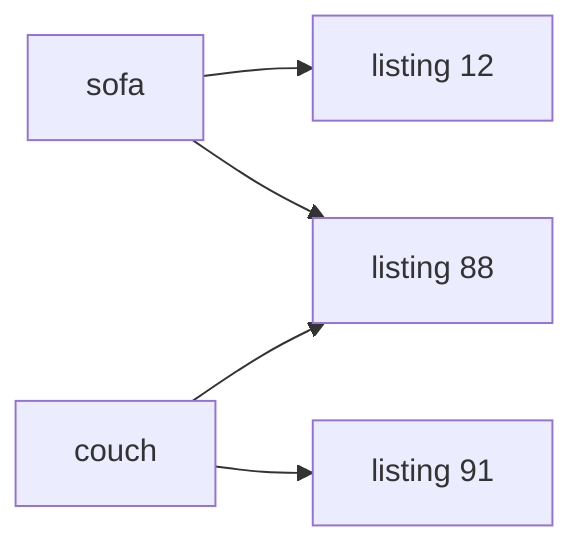

In [Part 0](/blog/search-evolution-ladder-0-measure-before-you-rank) we wrote down what a good result means and learned how to score a ranking with NDCG. Now it's time to build the first search on the ladder: the poor man's recency search. An **inverted index** finds listings that contain the words of a query, and we sort the matches newest first.

This simple setup separates two jobs that are easy to confuse: **finding** a product and **deciding where to show it**. Keep them apart in your head, because every later chapter improves one of the two.

Recency is not a silly choice. A buyer who checks a marketplace every morning wants to see what sellers posted overnight. For that visit, newest first is exactly right. Someone looking for a particular product cares less about when it arrived and more about how well it matches the search.

## Find the words

You could scan every listing for every request: read the text, keep the matches and sort them by date. That works for a small collection. As the catalog and the number of requests grow, you repeat the same work again and again.

An inverted index moves part of that work into a preparation step, before any request arrives[^1]. Read each listing and record which words it contains. The result is a dictionary from a word to the IDs of the listings that contain it. Search people call each collection of IDs a **postings list**.

Let's say "sofa" appears in listings 12 and 88, and "couch" appears in 88 and 91. A query that requires both words needs the intersection of those two collections: listing 88.

This Python example shows the lookup. The sets contain listing IDs, not scores:

```python
postings = {
    "sofa": {12, 88},
    "couch": {88, 91},
}

matches = postings["sofa"] & postings["couch"]
print(sorted(matches))  # [88]
```

The `&` operator keeps only IDs present in both sets. I sort the IDs only to make the output repeatable. It is not our ranking rule.



*Read each arrow as a lookup from a word to a listing ID. Listing 88 appears under both "sofa" and "couch", so it survives a query that requires both words. The index has not chosen a result order yet.*

The companion app for this series stores the IDs in sets[^2]. Listings that pass matching are **candidates**: we still need to decide their order. The app intersects the sets by checking each remaining ID against the next word's set. It does not sort the postings or start with the shortest one. Those would be separate optimizations.

Production engines usually store compressed, sorted postings. A basic merge of two sorted lists costs work proportional to their combined length in the worst case. Skip pointers and other lookup tricks avoid parts of that work, and starting with the rarest term reduces the number of candidates you check against the following terms.

Why does this matter? When you read performance claims, a set intersection and a sorted-list merge solve the same problem, but they do different work. For us, the main saving is simple: a request no longer reads every listing's text to find its words.

## Decide what counts as a match

The app splits the query into searchable units called **tokens**[^3]. Here, those are words or numbers. Chapter 1 requires every query token. A search for "pool floats" looks up "pool" and "floats" and keeps listings that contain both. It does not expand "floats" to "float" or "floating".

This is exact-token matching, not phrase matching. The words may appear far apart in a description. The index stores no token positions, so it cannot tell adjacent words from distant ones.

Exact matching also misses different vocabulary. A buyer types "couch" and the seller wrote "sofa". Unless the listing contains "couch" somewhere else, the buyer never sees it.

Word endings cause the same problem. Of the 97 products judged relevant for "pool floats", only six contain the literal token "floats", while 43 contain "float"[^4]. **No ranking formula can promote a product that matching has already excluded.**

Requiring every word is a choice, not a law. Add one unknown token to a query and the candidate set becomes empty, even if the other words would find useful products. You can relax the requirement, but then you have to decide which missing words you can tolerate. Losing "blue" and losing "sofa" do not have the same effect[^5].

## Put the newest match first

After matching, the app gives every candidate a recency score:

`recency = 1 / (1 + ageInDays)`

A listing posted today scores 1. A one-day-old listing scores 0.5, a ten-day-old listing about 0.09 and a hundred-day-old listing about 0.01.

The curve decreases with age, so sorting by this score gives newest-first order. For this chapter, any strictly decreasing function of age would produce the same order, apart from ties. The shape of the curve starts to matter in later chapters, when we combine recency with other scores.

Let me show the weakness with two matches. Listing A is exactly what the buyer wants, but it is 100 days old. Listing B mentions the query words somewhere in a long description and was posted today. B scores about a hundred times as much as A and comes first. The ranker has no signal for how well either listing answers the query.

WANDS, the product dataset introduced in Part 0, has no posted date. The data-import script generates dates across 180 days and produces the same dates on every run. Hence this chapter teaches the scoring rule, but it does not measure the value of real freshness. Listings with equal scores follow a fixed ID order.

## Measure the baseline

Chapter 1 scores **NDCG@10 0.393** across the 246 judged queries. On "pool floats" it scores 0.205.

That's not great, and that's fine. We now have an order to compare every later change against, and that's the reason to keep the baseline. Its simplicity makes it easy to tell whether a change found new candidates, reordered existing ones or did both.

A score of 0.393 does not mean that 39.3 percent of users succeeded. It is the mean normalized gain defined in Part 0. Treat it as a comparison on this judgment set, not as a business metric.

## The decisions a live catalog adds

A live index must handle new listings, edits and deletions. The app builds its index from a fixed collection, so it never has to decide how long a seller waits before a change becomes searchable. Your production system has to.

You also need to define the date. Is it the original posting time, the last edit or the last paid bump? If you use the edit time, a seller can make an old listing look fresh by fixing a typo. Set that policy before you tune any formula.

The app reads title and description as one text. It gives no extra weight to a word in the title and stores no positions for phrase queries. Those are limits of this implementation, not limits of an inverted index.

## What's next

The next chapter changes the words we look up. Stemming and synonym expansion let a buyer find a listing even when the seller used different wording. The order stays newest first, so we can inspect the matching change on its own.

In the [companion app's recency chapter](https://search-evolution-explorer.sebastiansigl.com/level/level-1-recency), compare the results for "couch" with the results for "sofa". The difference between those two lists is the next problem to solve.

Happy searching :)

---

[^1]: Manning, Raghavan and Schütze explain inverted indexes and postings-list intersection in chapter 1 of "Introduction to Information Retrieval": https://nlp.stanford.edu/IR-book/

[^2]: The app shows the implementation of every chapter at https://search-evolution-explorer.sebastiansigl.com/code

[^3]: Tokenization decides where searchable units begin and end. Hyphens, apostrophes and language-specific word boundaries make this more than splitting on spaces: https://nlp.stanford.edu/IR-book/html/htmledition/tokenization-1.html

[^4]: The counts refer to the judged products for "pool floats". A product can contain both forms, so the two counts overlap.

[^5]: Vespa's query API documents matching choices and how they relate to ranking: https://docs.vespa.ai/en/querying/query-api.html
