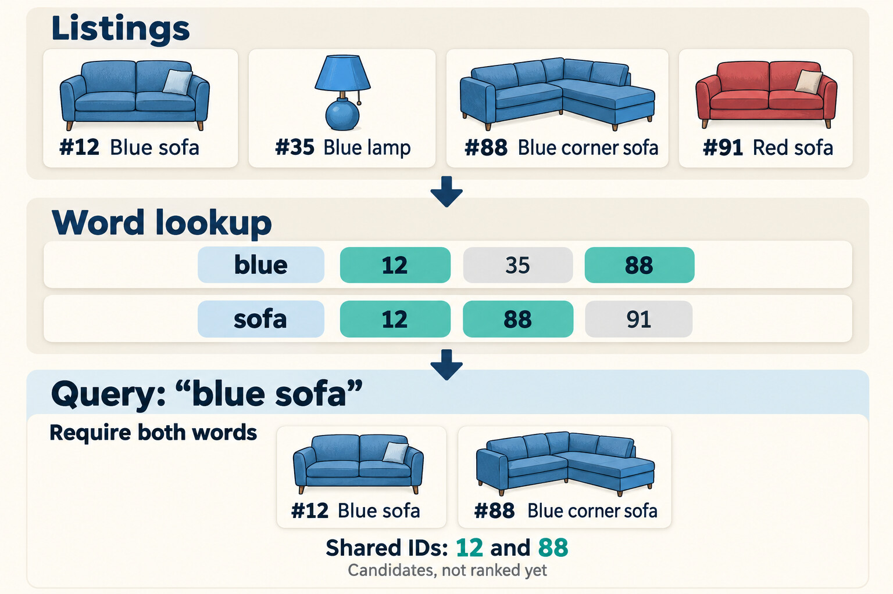

In [Part 0](/blog/search-evolution-ladder-0-measure-before-you-rank), we wrote down what a good result means and learned how to measure a ranking with NDCG. Now let's build our first search.

We'll start with something simple: find listings that contain the query words, then put the newest ones first. The poor man's recency search.

That might sound too simple. But imagine checking a marketplace every morning for a used bike. You already looked through yesterday's listings. What you want to know is what arrived overnight. Newest first makes sense.

Now imagine you need a particular replacement part. A listing from three months ago might be exactly right. Something posted five minutes ago might be useless.

Both are reasonable ways to use search. They just ask different things of the result order.

Before we make search smarter, we need to understand two jobs: **which listings get into the results**, and **which ones appear at the top**.

## Find the words without reading everything

Suppose we have millions of listings and someone searches for "blue sofa".

We could read every title and description, check whether both words appear, and keep the matches. It would work. But when the next person searches for "wooden table", we'd read all of them again.

Most of that work is unnecessary. We already had the text when the seller published the listing. We just need to store it in a structure that answers "which listings contain this word?" directly.

That's the idea behind an **inverted index**[^1].

Normally, we think of a listing as pointing to its words. A listing "blue sofa comfortable" contains "blue", "sofa" and "comfortable". An inverted index turns that relationship around: each word points to the listings that contain it.

Each collection of listing IDs is called a **postings list**.

For "blue sofa", we look up "blue" and "sofa". So we operate on sets and can use set operations. For example, if we require both words, we keep the IDs that appear in both lists, which is called an intersection.

Postings lists are sorted by listing ID, so we can walk both lists side by side in a single pass. The work grows with the length of the two lists, not with the size of the catalog.

We haven't decided whether one listing is better than another. We only know that both passed our matching rule. They are now **candidates**.

This splits the work into two phases. At **index time**, we process the text when a listing is published or updated. At **query time**, we only look up words and combine their postings lists.

Common words can still produce enormous lists. Production engines compress them and store skip pointers to jump over IDs that can't match. When several words are required, one smart optimization is starting with the rarest one to reduce work: it gives us fewer candidates to check against the others[^2].

For now, the main idea is enough. We no longer read every listing's text at query time.

## What does "contains the words" actually mean?

Let's stay with "blue sofa".

Before looking anything up, a search engine breaks text into searchable units called **tokens**. In a simple setup, those are roughly words and numbers. We usually normalize them too, for example by turning "Blue" into "blue", so capitalization doesn't prevent a match.

The devil is in the detail. Is "second-hand" one token or two? What happens to an apostrophe? Different languages need different decisions. German writes "Ecksofa" as one word where English writes "corner sofa", so a search for "sofa" misses it unless we split compounds[^3]. The query and the listing text need compatible processing, or we can miss matches and our search starts to feel broken.

For this first step, we'll keep the rule simple: every query token must appear in the listing.

That sounds sensible, but notice what it does and doesn't promise.

A listing titled "Blue sofa, barely used" matches, and for the right reason. A listing titled "Red sofa" with the description "Selling this because we bought a blue one." matches too, because a search that indexes titles and descriptions finds both "blue" and "sofa". But only one is a blue sofa.

Finding words doesn't tell us how those words relate to each other. Requiring them to appear next to each other would be a phrase query, which needs information about their positions. An inverted index can store positions, but a basic word-to-ID lookup doesn't[^4].

Even phrase matching is not a solution that makes all searches work. A listing titled "Blue sofa cover" contains the exact phrase "blue sofa", which is a very different search intent.

This is an early lesson in search: **a text match is evidence of relevance, not proof of it.**

## The results we never get to rank

Exact-token matching has another weakness. Buyers and sellers don't always use the same words.

A buyer searches for "couch". The seller wrote "sofa". Both mean the same thing in this situation, but our index has separate entries for the two words. Without a rule connecting them, that listing never becomes a candidate.

Word endings cause similar problems. A search for "blue sofas" won't match a listing containing only "blue sofa" if we treat "sofas" and "sofa" as different tokens.

We can have a catalog full of useful products and still return very little.

Requiring every word makes this more noticeable as queries get longer. Suppose someone searches for "comfortable blue sofa". A seller might describe the color, dimensions and condition without ever using "comfortable". Our rule excludes the listing anyway. In the extreme, one query word that no listing contains leaves us with no results at all.

We could accept listings containing only some of the words. But which words are safe to lose?

Dropping "comfortable" might be fine. Dropping "sofa" could fill the results with blue cushions, chairs and curtains.

We'll return to these decisions later in the series. For now, remember this:

**No ranking formula can promote a listing that matching has already excluded.**

When search results are disappointing, it's tempting to adjust the ranking. First check whether the products you wanted were candidates at all.

## Put the newest match first

Once we have our candidates, we need an order.

For newest first, we can sort directly by posting date. That's all we need.

We can also express freshness as a score. One simple formula is:

`recency = 1 / (1 + ageInDays)`

It gives us:

| Listing age | Recency score |
|---|---|
| Posted today, age 0 days | 1.00 |
| 1 day | 0.50 |
| 10 days | 0.09 |
| 100 days | 0.01 |

The score falls as age grows, so sorting by it gives the same order as sorting by date. Any strictly decreasing function of age does.

Why introduce a score at all? Later, we may want to combine freshness with other signals. Then the shape of the curve matters: it determines how quickly the freshness contribution fades.

Let's return to our sofas, now with posting dates. The barely used blue sofa was posted ten days ago. The red sofa whose description mentions a blue replacement was posted this morning. So was a listing titled "Blue couch".

The blue couch never becomes a candidate, because it doesn't contain "sofa". The other two pass matching, and the red one comes first.

The blue couch is lost during matching. The older blue sofa loses its position during ordering.

Our search is doing exactly what we asked. It found the words and sorted by date. We simply haven't given it any way to prefer the listing that better answers the query.

## When newest first is useful

Freshness can be valuable in a marketplace. A buyer watching a busy category may want to discover new listings before someone else buys them. For that person, repeatedly showing an older, highly relevant listing can be frustrating. They've already seen it.

But freshness is still an assumption about what matters to the buyer.

An older listing isn't necessarily worse. A newly posted listing isn't necessarily available. And neither date tells us whether the item is the right model, the right size or even the right kind of product.

This is why newest first can be a useful sorting option without being the best default for every search.

There's also a product decision hiding inside the word "newest": which date do we mean?

The original posting time? The last edit? The last paid bump?

If every edit resets the date, fixing a typo can move a listing above everything posted since it first appeared. That might be intentional, but it should be a deliberate policy. A scoring formula can't make that decision for us.

## Keep a baseline you can learn from

A simple search is useful because its behavior is easy to explain.

If a relevant listing is missing, we can inspect the matching rule. If it appears too far down, we know the date determined its position. As we add features, we can ask whether they found more useful candidates, improved their order, or did both.

In the [companion app](https://search-evolution-explorer.sebastiansigl.com/), this baseline reaches **NDCG@10 of 0.393** across 246 judged queries. The WANDS dataset has no dates, so the app derives one per listing from a hash of its ID: an age between 0 and 179 days, the same on every run. That makes the score reproducible. It also means the dates say nothing about relevance. Among the candidates, the order is effectively arbitrary, so 0.393 mostly tells us how good our matching is.

The purpose of a baseline is to give the next change something concrete to beat.

## What's next

We now have a search that can find words efficiently and put the newest matches first. We also know where it struggles: different words for the same thing, different word endings and query words that a good listing doesn't contain.

In Part 2, we improve matching. Stemming and synonym expansion help connect what buyers type with what sellers write. We'll keep the order newest first so we can see what the matching change achieves on its own.

If you'd like to explore this baseline, read the [companion app's recency chapter](https://search-evolution-explorer.sebastiansigl.com/level/level-1-recency), then search for ["couch"](https://search-evolution-explorer.sebastiansigl.com/search?q=couch&level=level-1-recency) and ["sofa"](https://search-evolution-explorer.sebastiansigl.com/search?q=sofa&level=level-1-recency). Think about how much overlap you would expect between those searches.

That gap between the words people use and the things they mean is our next problem to solve.

Happy searching :)

---

[^1]: Christopher D. Manning, Prabhakar Raghavan, Hinrich Schütze. *Introduction to Information Retrieval*. Cambridge University Press, 2008. §1.2 "A first take at building an inverted index", §1.3 "Processing Boolean queries". https://doi.org/10.1017/CBO9780511809071

[^2]: Manning et al. 2008, §1.3 "Processing Boolean queries", §2.3 "Faster postings list intersection via skip pointers", ch. 5 "Index compression". https://doi.org/10.1017/CBO9780511809071

[^3]: Manning et al. 2008, §2.2.1 "Tokenization". https://doi.org/10.1017/CBO9780511809071

[^4]: Manning et al. 2008, §2.4.2 "Positional indexes". https://doi.org/10.1017/CBO9780511809071
