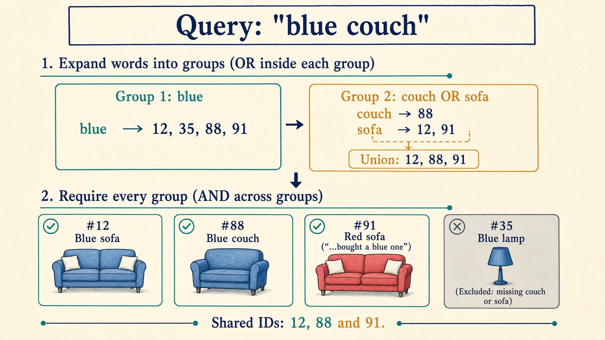
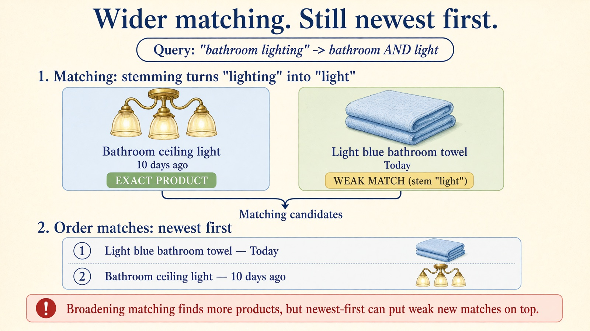

In [Part 1](/blog/search-evolution-ladder-1-find-the-words-sort-by-date), we built our first search: look up the query words in an inverted index, require all of them to appear, and sort the matches newest first.

We also saw where that strict matching struggles. A buyer searches for "blue sofa", and a listing titled "Blue couch" posted this morning never even becomes a candidate. Neither does a search for "blue sofas" if the seller only wrote "Blue sofa".

So far, we've left that problem to the buyer. When the results look thin, they have to guess which words the seller might have used and search again.

We can do that work for them. In this part, we'll relax exact-word matching with three rules: **spelling variants**, **stemming** and **synonyms**. We'll keep the newest-first ordering untouched so we can see what changing the matching rule does on its own.

## Three ways the same thing gets written differently

When buyers and sellers miss each other on words, it usually happens in one of three ways.

First, **spelling and spacing variants**. One person writes "mid-century", another writes "mid century", and a third writes "midcentury". After basic tokenization removes punctuation, "mid-century" and "mid century" both become two tokens (`mid` and `century`), while "midcentury" is one token (`midcentury`). Without a rule that normalizes them to the same form, they won't match each other[^1].

Second, **word endings**. A buyer searches for "blue sofas" or "bathroom lighting", while the seller wrote "Blue sofa" or "Bathroom ceiling light". In English, plurals and suffixes like `-s`, `-es` and `-ing` change the surface word without changing the core meaning. **Stemming** strips common endings with a rule-based algorithm so related forms meet on the same stem: "sofas" becomes "sofa", and "lighting" becomes "light"[^2]. A stem doesn't even have to be a real dictionary word: "midcentury" becomes `midcenturi`, and that's fine as long as both sides produce the same token.

Third, **synonyms**. "Couch" and "sofa" share no letters, so no spelling or suffix rule can connect them. Neither do "carpet" and "rug". For these, we need an explicit list of equivalent words.

Before running these rules, we also drop common **stop words** such as "the", "a", "of" and "in"[^3]. In a search that requires every query word, leaving stop words in would reject good listings just because the seller didn't write "in" or "the". Dropping them works well for product queries, though it has a cost when phrases like "the who" or "to be or not to be" matter.

## Turn each query word into a group of alternatives

Once a single query word can match more than one token, we need to be clear about how multi-word queries work.

Suppose someone searches for "blue couch", and we expand "couch" to include "sofa". We don't want listings that contain *any* of `blue`, `couch` or `sofa`. That would return red sofas and blue lamps. We still want every part of the buyer's query to be satisfied.

So each query word becomes a **group of alternatives**:

- Group 1: `["blue"]`
- Group 2: `["couch", "sofa"]`

A listing must match **at least one word in every group**. That means we combine postings lists with **OR (union)** inside each group, and combine the groups with **AND (intersection)**. Expanding "couch" does not make "blue" optional.

Suppose our catalog has four listings: a barely used blue sofa, a blue couch, a red sofa whose description mentions buying a blue one, and a blue lamp.

In Part 1, a search for "blue couch" matched only the blue couch. With "couch" expanded to include "sofa", the seating group finds the blue couch, the blue sofa and the red sofa. Intersecting that group with "blue" keeps all three, while still excluding the blue lamp.

## What happens at index time vs. query time?

For the query and the listing to meet, both sides have to speak the same normalized language.

When we build the index (**index time**), we normalize spelling variants and store both the original word and its stem for every listing. A listing that says "sofas" is indexed under both `sofas` and `sofa`.

Why store both? Because it lets us decide at **query time** whether stemming is switched on. If stemming is off, a query for "sofa" still matches listings that literally wrote "sofa". If stemming is on, it also reaches listings that wrote "sofas".

Synonyms, on the other hand, are expanded **only at query time**[^4]. When the seller writes "Blue sofa", we index `blue` and `sofa`. We don't write `couch` into the index. Instead, when the buyer searches for "couch", the query expands to look up both `couch` and `sofa`.

That's a practical engineering trade-off:

- Expanding synonyms at **query time** keeps the index smaller and lets us add, fix or remove a bad synonym rule immediately, without reindexing millions of listings.
- The price is that query time does slightly more work: it looks up and unions more postings lists. And for multi-word synonyms, query-time expansion can get tricky when scoring relies on how rare a word is across the catalog.

## A synonym rule is a product decision

A small synonym table like `sofa ↔ couch` and `rug ↔ carpet` looks harmless. Building one for a whole marketplace is much harder, because two words are rarely interchangeable in every context.

Even in furniture, a buyer searching for "sofa" might be happy with a couch, while a buyer searching for "couch cover" wants an accessory, not a piece of furniture. And what about "sofa" and "sectional", or "sofa" and "daybed"? Some buyers treat them as alternatives; others will feel the search doesn't understand what they asked for.

How do teams discover which words to connect? User behavior is a great starting point:

- If many users search for one word, don't click anything, and immediately rephrase to another word, that pair is a candidate[^5].
- If two different queries consistently lead to clicks on the same listings, they may express the same intent.

But behavior is a hint, not proof. A buyer who searches for "sofa" and then "coffee table" didn't just invent a synonym. They moved on to the next item in their living room. And a listing that gets clicked for two queries might simply be cheap or sitting at rank one.

Use logs and language models to *propose* synonym candidates, then have a human review them before they go live. Keep a clear owner for the table, and record example queries where a rule helps alongside queries where it shouldn't fire.

## More matches, but not every query gets better

When we turn on spelling variants, stemming and synonyms in the [companion app](https://search-evolution-explorer.sebastiansigl.com/), mean **NDCG@10 rises from 0.393 to 0.421** across the 246 judged queries.

On average, meeting the seller halfway helps. Queries like "mid century modern", which found nothing when the query and index treated the hyphen differently, now find matching listings.

Still, some queries get worse. Why would finding more words hurt a search? Two reasons show up right away:

1. **Stemming and synonyms can merge different meanings.** Suppose someone searches for "bathroom lighting". Stemming turns "lighting" into `light`. That matches a bathroom ceiling light, which we want, but it also matches a light blue bathroom towel. Outside this example, an English stemmer will also merge "universe" and "universal" into `univers`[^2].
2. **Our ordering is still newest first.** Whenever we broaden matching, we admit more candidates into the pool. Some are the exact products we missed in Part 1. Others are weak matches that only share a stem or a loose synonym. Because we still sort purely by date, a weak new match posted today jumps straight above a relevant listing posted ten days ago.

**Broadening matching increases recall, but without a relevance score it can push good results down.**

## What's next

We've made our matching much more forgiving. Buyers no longer have to guess whether a seller wrote "sofa", "sofas" or "couch", or whether "mid-century" has a hyphen.

Now our candidate set is larger, and our newest-first sorting is showing its limits. When hundreds of listings match, we need a way to tell which ones are actually about the buyer's query, and which ones only mention the words in passing.

In Part 3, we keep this exact same candidate set and replace pure recency ordering with **BM25**, a text-ranking formula that weighs how rare a query word is, how often a listing repeats it, and how long the listing is.

Try the [normalization chapter in the companion app](https://search-evolution-explorer.sebastiansigl.com/search?level=level-1-normalization). Search for ["carpet"](https://search-evolution-explorer.sebastiansigl.com/search?q=carpet&level=level-1-normalization) or ["mid century modern"](https://search-evolution-explorer.sebastiansigl.com/search?q=mid+century+modern&level=level-1-normalization), and toggle the three levers—variants, stemming and synonyms—on and off to see which listings enter the candidate set and which ones take the top spots.

Happy searching :)

---

[^1]: Christopher D. Manning, Prabhakar Raghavan, Hinrich Schütze. *Introduction to Information Retrieval*. Cambridge University Press, 2008. §2.2.3 "Normalization (equivalence classing of terms)". https://doi.org/10.1017/CBO9780511809071

[^2]: Manning et al. 2008, §2.2.4 "Stemming and lemmatization". https://doi.org/10.1017/CBO9780511809071; Martin F. Porter. "An algorithm for suffix stripping". *Program*, 1980. https://doi.org/10.1108/eb046814

[^3]: Manning et al. 2008, §2.2.2 "Dropping common terms: stop words". https://doi.org/10.1017/CBO9780511809071

[^4]: Claudio Carpineto, Giovanni Romano. "A Survey of Automatic Query Expansion in Information Retrieval". *ACM Computing Surveys*, 2012. https://doi.org/10.1145/2071389.2071390

[^5]: Rosie Jones et al. "Generating query substitutions". In *WWW 2006*. https://doi.org/10.1145/1135777.1135835
