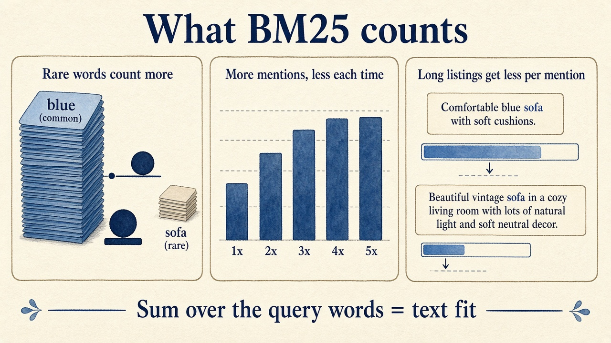
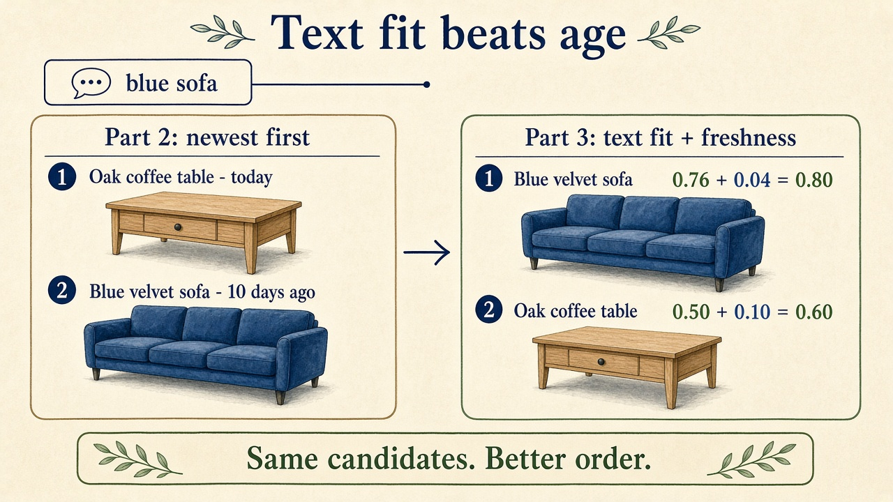

In [Part 2](/blog/search-evolution-ladder-2-meet-the-seller-halfway-on-words), we made matching more forgiving. Spelling variants, stemming and synonyms now bring in listings that strict matching missed.

As in the earlier parts, we use a marketplace like eBay as our example: sellers write their own listings, and good listings are often gone after a few days. Other businesses work differently, so some of the choices in this part depend on yours.

But more candidates also means more listings that only mention the query words in passing. And we still sort newest first.

A buyer searches for "blue sofa". Two listings match:

- **Blue velvet sofa**, posted ten days ago: "Blue velvet sofa, three seats. The sofa is barely used, no stains."
- **Oak coffee table**, posted today: a long description about the wood, the size and the drawers, and somewhere in the middle "it looks great in front of a blue sofa".

Both contain "blue" and "sofa", so both are correct matches. Newest first puts the coffee table on top. The buyer sees a table on top of a sofa search, and our search starts to feel broken again.

So matching did its job, both listings belong in the result. What we need now is a better order.

In this part, we keep exactly the same candidates as in Part 2 and only change how we order them. We score each listing by how well its text fits the query, with a formula called **BM25**[^1].

## What makes one listing fit the words better than another?

Look at the two listings with the eyes of a buyer. We feel right away that the first one is about the query, and the second one only mentions the words in passing.

BM25 turns that feeling into three kinds of evidence:

1. **Rare words count more.** Almost every listing in a home catalog contains some common word. A word that appears in only a small part of the catalog tells us much more about what a listing is. This is the **inverse document frequency**, or IDF[^2].
2. **More mentions help, but less each time.** A listing that says "sofa" twice is probably more about sofas than one that says it once. Ten times shouldn't be worth ten times as much, though. The parameter `k1` controls how fast the extra reward flattens out.
3. **Long listings get less credit per mention.** A long description has more chances to contain a query word by accident. BM25 compares each listing's length with the average length in the catalog. The parameter `b` controls how strong that correction is.

The sofa listing wins on all three. It repeats the rarer word "sofa", and it is short. The coffee table says each word once, in a long text.



## Let's calculate it by hand

Consider a small catalog of 1,000 listings with an average length of 100 words. Suppose "sofa" appears in 50 listings and "blue" in 200. We use `k1 = 1.2` and `b = 0.75`, the usual defaults[^3].

BM25 calculates two things for each query word. First, how rare the word is in the whole catalog:

```text
idf = ln(1 + (N - df + 0.5) / (df + 0.5))

N  = number of listings in the catalog
df = number of listings that contain the word

"sofa":  ln(1 + (1000 - 50 + 0.5) / (50 + 0.5))   = ln(1 + 18.82) = ln(19.82) ≈ 2.99
"blue":  ln(1 + (1000 - 200 + 0.5) / (200 + 0.5)) = ln(1 + 3.99)  = ln(4.99)  ≈ 1.61
```

"Sofa" is in four times fewer listings, so a match on it counts almost twice as much.

Second, how much one listing says about the word. It scales the IDF by how often the word appears (`tf`) and how long the listing is:

```text
score = idf * tf * (k1 + 1) / (tf + k1 * lengthFactor)

lengthFactor = 1 - b + b * length / averageLength

with k1 = 1.2 and b = 0.75:  k1 + 1 = 2.2  and  1 - b = 0.25
```

The `lengthFactor` is 1 for a listing of average length, smaller for a shorter one and larger for a longer one. The listing score is the sum over all query words. Now let's put in our two listings:

```text
Blue velvet sofa: 20 words, "sofa" 2x, "blue" 1x
  lengthFactor = 0.25 + 0.75 * 20 / 100 = 0.40
  "sofa":  2.99 * 2 * 2.2 / (2 + 1.2 * 0.40) = 13.14 / 2.48 ≈ 5.30
  "blue":  1.61 * 1 * 2.2 / (1 + 1.2 * 0.40) =  3.54 / 1.48 ≈ 2.39
  text fit                                                 ≈ 7.69

Oak coffee table: 80 words, "sofa" 1x, "blue" 1x
  lengthFactor = 0.25 + 0.75 * 80 / 100 = 0.85
  "sofa":  2.99 * 1 * 2.2 / (1 + 1.2 * 0.85) =  6.57 / 2.02 ≈ 3.25
  "blue":  1.61 * 1 * 2.2 / (1 + 1.2 * 0.85) =  3.54 / 2.02 ≈ 1.75
  text fit                                                 ≈ 5.00
```

Both listings contain the same query words, and still the one that is about a blue sofa scores higher. Most of the gap comes from "sofa": it's the rarer word, the sofa listing says it twice, and its text is short.

Now let's see what keyword stuffing buys a seller. If our 20-word sofa listing said "sofa" ten times instead of twice, the "sofa" part would rise from 5.30 to about **6.27**. So with five times the mentions, the seller gets less than 20% more score. BM25 makes keyword stuffing much less attractive, but the seller still gains a little from it.

## How many days is a better match worth?

We don't throw away the date. A fresh listing is more likely to still be available, so we want it to count. But how much should a few days of age be worth?

With raw BM25, we can't answer that, because BM25 has no fixed upper limit: our sofa scores 7.69, but in a large catalog a query with rarer words can score much higher. Any recency bonus we add is worth a lot for one query and almost nothing for another.

So let's first put text fit on a fixed scale. Every BM25 word part has an upper limit. When a word repeats more and more, `tf * (k1 + 1) / (tf + k1 * lengthFactor)` gets closer and closer to `k1 + 1`, whatever the length. So the best score a query can ever give is known up front, and we can divide by it[^4]:

```text
maxScore = sum over the query words of idf * (k1 + 1)
         = (2.99 + 1.61) * 2.2 ≈ 10.11

textFit  = bm25 / maxScore          → always between 0 and 1

Blue velvet sofa:  7.69 / 10.11 ≈ 0.76
Oak coffee table:  5.00 / 10.11 ≈ 0.50
```

Dividing by the same number doesn't change the order within a query. It only gives every query the same scale, so a bonus means the same everywhere.

Now we can write the trade-off down. We give a listing posted today a freshness bonus of 0.1, and let it halve every week:

```text
score     = textFit + 0.1 * freshness
freshness = 0.5 ^ (ageInDays / 7)

Blue velvet sofa, 10 days old:  0.76 + 0.1 * 0.37 ≈ 0.80
Oak coffee table, posted today: 0.50 + 0.1 * 1.00 = 0.60
```



The sofa ranks first, even though the coffee table is ten days newer. And now we can say exactly how much being new is worth:

- A listing posted today beats one from **a week ago** only if its text fit is at most **0.05** lower.
- Against one from **two weeks ago**, it may be at most **0.075** lower.
- **No age difference** is ever worth more than 0.1 of text fit.

So freshness only decides between listings that fit the query about equally well.

This formula is also the first time we combine signals with weights, and I think it's an important step in the series. Each signal lies between 0 and 1, and its weight tells us how much it can move a listing at most. Text fit can move a listing by up to 1, freshness by up to 0.1.

In the next parts, more signals join the same way: does the listing match the product type the buyer asked for, does the price fit, is the title any good. Each one gets its own weight:

```text
score = 1.0 * textFit + 0.1 * freshness + w3 * signal3 + w4 * signal4 + ...
```

Because all signals share the same scale, we can compare the weights directly. A boost with a weight of 0.1 counts as much as being posted today. And once we have many signals, picking the weights by hand gets hard, so later in the series we let data choose them.

I chose 0.1 and 7 days for this example. For your own product, you pick them yourself. If good listings sell within days, as on our marketplace, you might want a larger weight or a shorter half-life. A shop with fixed stock might not need a freshness bonus at all. The nice part is that you can now talk about it with your product team in their terms: "a new listing may be this much worse and still win against a week-old one". Then you test your choice with real users.

A text fit of 0.76 also doesn't mean the listing is 76% relevant. The scale is the same for every query, but the same value can mean a better match for one query than for another.

## Use the same analyzer for the statistics

BM25 depends on counts: how many listings contain a word, how often a listing repeats it, and how long the listing is. The devil is in the detail here.

The counts must use the same text processing as the query. In Part 2, the query "lighting" becomes the stem `light`. If the index counted the document frequency of "lighting" instead of `light`, BM25 would give the word the wrong weight.

The same is true for length. If the index stores both the normalized word and its stem, as we did in Part 2, a listing's analyzed length can be longer than its word count. That's fine, as long as the query side and the index side count the same way.

And a live catalog changes every minute. A word that suddenly appears in thousands of new listings should lose some of its rarity weight. So you need a plan for when to update these statistics.

## Does better text fit mean better search?

In the [companion app](https://search-evolution-explorer.sebastiansigl.com/search?level=level-1-lexical), BM25 raises mean **NDCG@10 from 0.421 to 0.536** across the 246 judged queries. And we didn't add a single new candidate. We only changed the order.

This is why we [measure before we rank](/blog/search-evolution-ladder-0-measure-before-you-rank). Without the judged queries, we couldn't tell if a gain came from finding new listings or from moving good ones up.

Still, BM25 only counts words. It doesn't know what the buyer wants:

- **It doesn't know the product type.** A search for "lamp" scores a lamp and a lamp shade similarly, because both say "lamp".
- **It doesn't know which meaning of a word the buyer wants.** Remember "bathroom lighting" from Part 2: stemming turns it into `light`, so a light blue bathroom towel matches. If the towel's description is short, BM25 can rank it above a bathroom ceiling light, because both listings contain the same words.
- **It ignores word order and closeness.** With the same counts and length, "table lamp" and "lamp table" get the same score, and so does a listing where the two words are far apart. Features such as word proximity, or how much of the query the title covers, get us closer to what the buyer means. We come back to them in a later part.
- **It can't rank what isn't there.** A typo like "sofq" matches no listing, so BM25 has nothing to score.

When I look at queries that got worse, I usually find one of these cases. Then I decide which one hurts my users most, and fix that first.

## What's next

We now order the candidates by how well their text fits the query, and the blue sofa finally beats the coffee table.

But BM25 can only score listings that matching lets through. In Part 4, we take on the typo. When a buyer types "sofq", we want to find the word they meant before matching even starts.

Try the [BM25 chapter in the companion app](https://search-evolution-explorer.sebastiansigl.com/search?level=level-1-lexical). Search for ["blue sofa"](https://search-evolution-explorer.sebastiansigl.com/search?q=blue+sofa&level=level-1-lexical) or ["bathroom lighting"](https://search-evolution-explorer.sebastiansigl.com/search?q=bathroom+lighting&level=level-1-lexical), compare the order with the normalization chapter, and look at the [code](https://search-evolution-explorer.sebastiansigl.com/level/level-1-lexical) to see the formula in about 30 lines.

Happy searching :)

---

[^1]: Stephen Robertson, Hugo Zaragoza. "The Probabilistic Relevance Framework: BM25 and Beyond". *Foundations and Trends in Information Retrieval*, 2009. https://doi.org/10.1561/1500000019

[^2]: Karen Spärck Jones. "A statistical interpretation of term specificity and its application in retrieval". *Journal of Documentation*, 1972. https://doi.org/10.1108/eb026526

[^3]: Christopher D. Manning, Prabhakar Raghavan, Hinrich Schütze. *Introduction to Information Retrieval*. Cambridge University Press, 2008. §11.4.3 "Okapi BM25: a non-binary model". https://doi.org/10.1017/CBO9780511809071

[^4]: The limit follows from the saturating term-frequency part of BM25, which approaches `k1 + 1` as `tf` grows. For other ways to put scores on a 0-to-1 scale, such as min-max normalization per result list: Mark Montague, Javed A. Aslam. "Relevance score normalization for metasearch". In *CIKM 2001*. https://doi.org/10.1145/502585.502657
