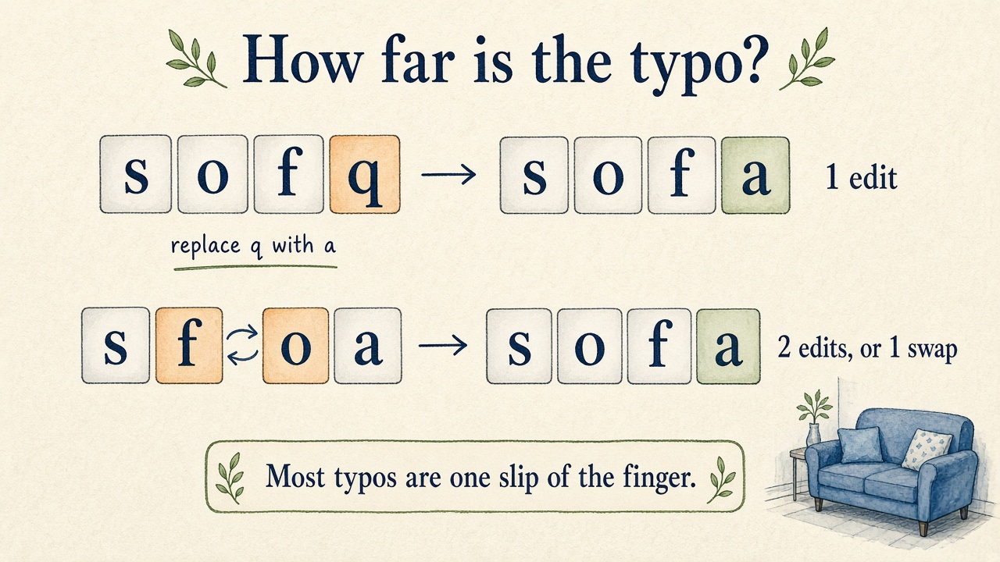
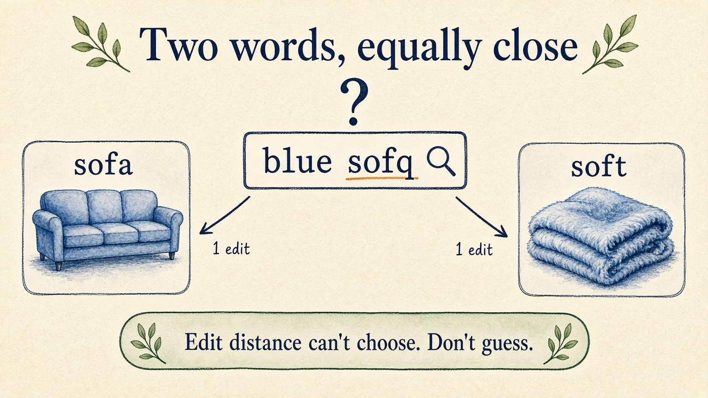

In [Part 3](/blog/search-evolution-ladder-3-rank-by-text-fit), we ordered the candidates by how well their text fits the query. The blue velvet sofa finally ranks above the coffee table.

But ranking can only order what matching lets through. A buyer sits on the train, types "blue sofq" on the phone and hits search. No listing contains the word "sofq", and we require every query word to appear, so the result page is empty.

The buyer doesn't think "I made a typo". The buyer thinks "they have no blue sofas", and our search feels broken, even though the catalog is full of them.

So before we look anything up, we want to repair the query. In this part, we build a small **spelling corrector** from the words our sellers wrote, and we find out why it sometimes has to leave a typo alone.

## Which words do we know?

To notice a typo, we first need to know what a correct word looks like. We could load an English dictionary, but usually each application has its own language. On this post, we again put us in the shoes of a marketplace similar to eBay.

A brand name like "Moen" is in no dictionary, and a dictionary word that no seller ever used can't match a listing anyway. So we take the **vocabulary** from the catalog itself: every word that appears in our listings. Consider having millions of listings. Whatever a buyer can find is in there.

A search build for a correction use case requires a mental shift. A query word that is in our catalog is not what matters. Only an unknown word like "sofq" gets corrected, and only into a word from the our catalog, so every correction can find something.

The devil is in the detail here. Sellers make typos too. If one seller writes "coffe table", then "coffe" is a word in our catalog. A buyer who makes the same typo is not corrected and sees that one listing, and none of the thousands of coffee tables. While there a many much more complicated solutions to that problem, a simple protection is a minimum count: a word only enters the vocabulary if it appears in at least a few listings. It removes the one-off typos, but a typo that several sellers make stays in. Other solutions deserve a dedicate blogpost, so lets move to how we can calculate a distance to familar words in our catalog.

## How far is "sofq" from "sofa"?

We need a way to say that "sofq" is close to "sofa" and far from "table". The classic answer is the **edit distance**, also called Levenshtein distance: the smallest number of single-letter edits that turn one word into the other[^1]. There are three kinds of edits:

- **replace** a letter: "sofq" → "sofa"
- **insert** a letter: "sfa" → "sofa"
- **delete** a letter: "sofaa" → "sofa"

"Sofq" needs one replacement to become "sofa", so the distance is 1. To get from "sofq" to "table", we'd have to change almost every letter.



But how does a program find the *smallest* number of edits? Trying every possible sequence of edits would take forever. The trick is to solve small versions of the problem first and reuse their answers.

We fill a table. Each cell answers one small question: how many edits turn the first letters of the typo into the first letters of the word? Here is the table for "sofq" and "sofa":

```text
          ""   s   o   f   a
    ""     0   1   2   3   4
    s      1   0   1   2   3
    o      2   1   0   1   2
    f      3   2   1   0   1
    q      4   3   2   1   1   ← the answer is in the last cell
```

The first row and the first column are easy. To turn nothing into "sof", we insert three letters. To turn "sof" into nothing, we delete three.

Every other cell looks at three neighbours that are already filled and takes the cheapest way to get there:

- from the cell **above**, plus 1: delete a letter of the typo
- from the cell to the **left**, plus 1: insert a letter of the word
- from the cell **diagonally above**: plus 0 if the two letters are the same, plus 1 to replace one with the other

Follow the diagonal: "s", "o" and "f" are the same in both words, so the cost stays at 0. In the last cell, "q" and "a" differ, so we pay 1 for the replacement. That last cell is the edit distance.

In Python, the whole algorithm is a few lines:

```python
def edit_distance(typo, word):
    # table[i][j] = edits to turn the first i letters of typo
    #               into the first j letters of word
    table = [[0] * (len(word) + 1) for _ in range(len(typo) + 1)]
    for i in range(len(typo) + 1):
        table[i][0] = i  # delete all i letters
    for j in range(len(word) + 1):
        table[0][j] = j  # insert all j letters

    for i in range(1, len(typo) + 1):
        for j in range(1, len(word) + 1):
            same = typo[i - 1] == word[j - 1]
            table[i][j] = min(
                table[i - 1][j] + 1,                      # delete a letter
                table[i][j - 1] + 1,                      # insert a letter
                table[i - 1][j - 1] + (0 if same else 1)  # keep or replace
            )
    return table[-1][-1]

print(edit_distance("sofq", "sofa"))   # 1
print(edit_distance("sofq", "table"))  # 5
```

For two words of four and five letters, that is a table of 30 cells, so one comparison is cheap.

Now we can search the vocabulary for words that are close to the typo. How close is close enough? Most typos are one slip of the finger. In an early study, more than 80% of the spelling errors were a single wrong, missing, extra or swapped letter[^2]. So a small budget is enough:

```text
words up to 4 letters:  at most 1 edit
longer words:           at most 2 edits
```

Short words get a smaller budget because they have so many neighbours. With two edits, "sofq" could also become "sold", "soap" or "safe", and the buyer meant none of them.

There is one typo this distance handles badly. When the buyer types "sfoa", two letters are swapped. For us that is one mistake, but the classic edit distance counts two replacements, and that is over the budget for a four-letter word. A common extension adds the **swap of two neighbouring letters** as a fourth edit that costs 1[^2]. If your users type on phones, I'd add it.

## What if two words are equally close?

Let's correct "sofq". We look for vocabulary words within one edit and find "sofa". Sadly, we also find "soft": replace the "q" with a "t", and it is a correct word too.

Both are real words from our catalog, and both are exactly one edit away. Edit distance compares letters and has no idea what the buyer wants, so for the corrector the two are equally good.



The careful rule is to **correct only when the closest word is unique**. With this rule, "sofq" stays as it is, and the buyer still gets an empty page. That hurts, but showing soft blankets to someone who wants a sofa is the worse mistake, because we changed the query and the buyer has to figure out why.

With the distance function from above, the whole corrector fits in a few lines. We measure the distance to every vocabulary word, keep the closest ones, and correct only when exactly one is left:

```python
def correct(word, vocabulary):
    if word in vocabulary:
        return word  # known words stay as they are

    budget = 1 if len(word) <= 4 else 2
    distances = {known: edit_distance(word, known) for known in vocabulary}
    best = min(distances.values())
    if best > budget:
        return word  # nothing is close enough

    closest = [known for known, distance in distances.items() if distance == best]
    return closest[0] if len(closest) == 1 else word  # a tie stays as typed

vocabulary = {"blue", "sofa", "soft", "velvet", "coffee", "table"}
print(correct("cofee", vocabulary))  # coffee
print(correct("sofq", vocabulary))   # sofq, because sofa and soft tie
```

To decide such a tie, we need more than letters:

- **How common is each word?** The more common word is the more likely one. Be careful where you count, though. In a home catalog, "soft" can easily appear in more listings than "sofa", because of all the soft blankets, soft pillows and soft-close drawers. What buyers search for is the better guide: in your query logs, far more people type "sofa" than "soft".
- **How likely is the slip?** On a keyboard, "q" sits right next to "a", and far away from "t". A corrector can weigh each candidate word by how likely the word is and how likely this exact typo is. This idea is known as the noisy channel model[^3].
- **What else is in the query?** Buyers search "blue sofa" much more often than "blue soft". The neighbouring words often settle what a single word can't[^4].

One tie is easy to decide without any of this. "Sofah" is one edit away from "sofa" and from "sofas". Both are forms of the same word, and in [Part 2](/blog/search-evolution-ladder-2-meet-the-seller-halfway-on-words) stemming made them match the same listings. So we pick the base form "sofa", and the buyer gets their sofas.

And we don't have to decide everything ourselves. When we are sure, we correct and say so above the results: "Showing results for blue sofa". When we are not sure, we can offer both: "Did you mean blue sofa or blue soft?" Either way, the buyer sees what we did and can undo it.

## Keep a short list for the typos you already know

Some typos come back every day. Take "ligth bulb". The right word is "light", with two letters swapped. Without the swap edit, "light" is two edits away. But one edit away, there is "ligh", a typo that several sellers made in their own listings. It is the unique closest word, so our corrector turns one typo into another, and the buyer gets a handful of listings with broken titles.

For such cases, I like a small list of **fixed rewrites** that we check before anything else:

```text
ligth  →  light
```

Your query logs tell you which typos belong on it. Look at the most frequent searches with no results. It's an afternoon of work, and it fixes the typos most of your buyers actually make.

## When the buyer forgets the space

On a phone, the space bar is easy to miss, and "blue sofa" becomes "bluesofa". No vocabulary word is within two edits of it.

So when no correction works, we try to **split the word in two**. We test every position and keep the split when both halves are known words: "blue" and "sofa" are in the vocabulary, so "bluesofa" becomes "blue sofa".

## When the correction is the mistake

A corrector can also break a query that was fine. Consider a buyer who searches for a bed by its product name: "Geralyn upholstered storage platform bed".

Only one listing in the catalog contains "Geralyn". Remember our minimum count: a word needs two listings to enter the vocabulary. So "geralyn" is unknown to the corrector, although the buyer spelled it perfectly. The closest known word is "merlyn", two edits away and unique. We search for a "Merlyn" bed, and the listing the buyer asked for by name is gone.

This is the price of the minimum count. The rule that keeps one-off seller typos out also keeps rare product names out. I see three ways to limit the damage:

- **Search as typed first.** If the original query finds listings, there is little reason to rewrite it. Correct when the result page is empty or almost empty.
- **Protect what must be exact.** Product names, brands and model numbers can come from their own list, so a single listing is enough to make them known words. And a word should never be corrected into a model number, or "table" might become "tab1e".
- **Show the correction.** The buyer who reads "Showing results for merlyn" can at least click back to what they typed.

## Does fixing typos make search better?

In the [companion app](https://search-evolution-explorer.sebastiansigl.com/search?level=level-1-spelling), spelling correction raises mean **NDCG@10 from 0.536 to 0.539** across the 246 judged queries.

That looks like almost nothing, so let's look inside. Only three of the 246 queries change at all. "Ligth bulb" goes from 0, an empty page, to 1.0, thanks to the fixed rewrite. The Geralyn bed drops from 0.40 to 0. The third one barely moves.

The mean is small because the judged queries are almost all spelled correctly. Your real buyers aren't that careful. To know what a corrector is worth for you, take the typos from your own query logs and build a small test set from them:

- typos that must be fixed
- rare names that must stay as they are
- ambiguous cases like "sofq", where you decide what should happen

Then you see the wins and the damage separately, and a mean can't hide one behind the other.

One more thing for a large catalog. We compare the typo with every word in the vocabulary. That works for a few tens of thousands of words. With millions of words, you prepare the lookup at index time. One smart approach is to store, for every vocabulary word, the versions with one or two letters deleted, so that a typo finds its candidates with a few lookups[^5].

## What's next

We now repair a query before matching starts: a unique close word replaces the typo, a missing space is put back, and a short list catches the typos we already know. And when two words are equally close, we'd rather ask than guess.

All of this still works on letters. In Part 5, we teach our search what the words mean. "Blue" is a colour and "sofa" is a product type, and a listing should match what the buyer asked for, and not only the words they used.

Try the [spelling chapter in the companion app](https://search-evolution-explorer.sebastiansigl.com/search?level=level-1-spelling). Search for ["blue sofah"](https://search-evolution-explorer.sebastiansigl.com/search?q=blue+sofah&level=level-1-spelling), ["bluesofa"](https://search-evolution-explorer.sebastiansigl.com/search?q=bluesofa&level=level-1-spelling) and ["blue sofq"](https://search-evolution-explorer.sebastiansigl.com/search?q=blue+sofq&level=level-1-spelling), see which ones get corrected, and look at the [code](https://search-evolution-explorer.sebastiansigl.com/level/level-1-spelling) to see how the corrector works.

Happy searching :)

---

[^1]: Christopher D. Manning, Prabhakar Raghavan, Hinrich Schütze. *Introduction to Information Retrieval*. Cambridge University Press, 2008. §3.3.3 "Edit distance". https://doi.org/10.1017/CBO9780511809071

[^2]: Fred J. Damerau. "A technique for computer detection and correction of spelling errors". *Communications of the ACM*, 1964. https://doi.org/10.1145/363958.363994

[^3]: Mark D. Kernighan, Kenneth W. Church, William A. Gale. "A spelling correction program based on a noisy channel model". In *COLING 1990*. https://doi.org/10.3115/997939.997975

[^4]: Manning et al. 2008, §3.3.5 "Context sensitive spelling correction". https://doi.org/10.1017/CBO9780511809071

[^5]: Wolf Garbe. *SymSpell*, a spelling correction library based on precomputed deletes. https://github.com/wolfgarbe/SymSpell
