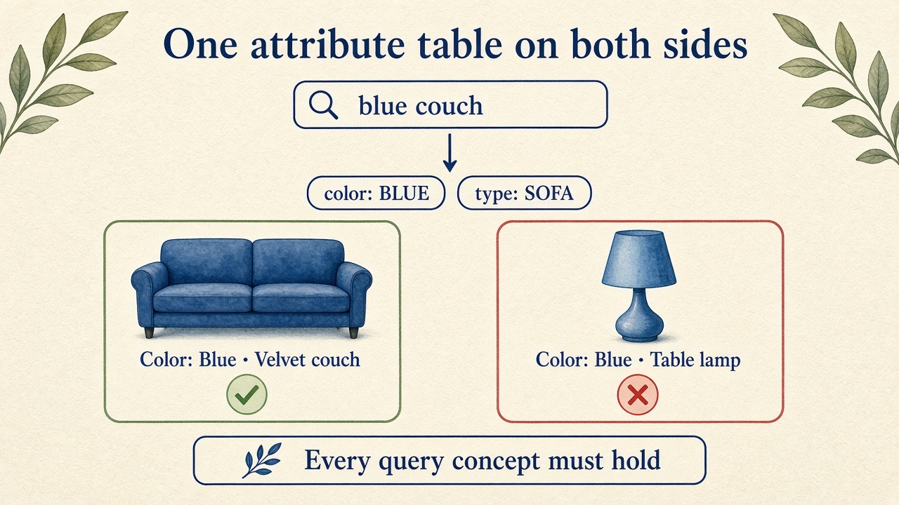
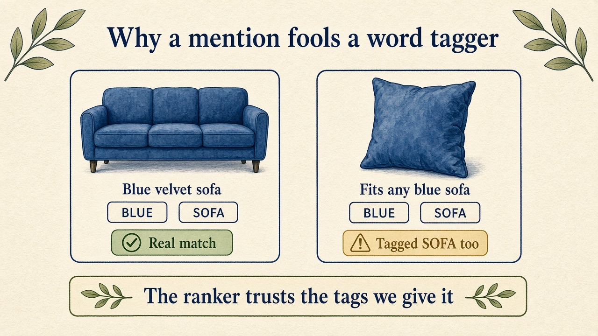

In [Part 4](/blog/search-evolution-ladder-4-fix-the-typo), we repaired typos before matching starts. A buyer who types "blue sofq" or "bluesofa" on the train now gets a real query instead of an empty page.

Even with clean spelling, every step we built so far treats a query as a flat bag of words. Our search still doesn't know what any word stands for.

Suppose a buyer on our marketplace searches for "blue sofa". Look at two listings in the catalog:

- **Velvet couch**: the seller picked `Color: Blue` in the listing form, so they didn't repeat "blue" in the title or description. Word matching never finds it, because "blue" isn't in the text.
- **Blue throw pillow**: "Soft blue throw pillow, fits any blue sofa or armchair." Word matching finds it, and because its description is short, BM25 can score it surprisingly high.

Both problems come from the same gap. Our search sees the words "blue" and "sofa", yet it doesn't know that "blue" is a **color** and "sofa" is a **product type**. It can't connect what the buyer typed to the fields the seller already filled in, and it can't tell an attribute of the product from a passing mention.

In this part, we teach our search to recognize **attributes** on both sides (color, material, brand and product type), use them to find listings that word matching missed, and reward listings whose attributes match what the buyer asked for.

## Give words roles with one shared table

Before we can match on attributes, we need to recognize them in a query[^1]. On a marketplace, a buyer types "blue couch" into one search box. They don't pick a color dropdown and a product-type dropdown first.

So we translate the query into **concepts**: typed attribute values such as `color: BLUE`, `material: VELVET`, `brand: MOEN` or `productType: SOFA`. Both the query and the listing use the same **attribute table**, where each concept lists the words or phrases (called **aliases**) that name it:

```text
color: BLUE          ←  "blue"
color: GRAY          ←  "gray", "grey"
material: VELVET     ←  "velvet"
productType: SOFA    ←  "sofa", "couch", "loveseat"
```

This step runs right after spelling correction. If the buyer typed "bluesofa", Part 4 splits it into "blue sofa", and then the tagger reads `color: BLUE` and `productType: SOFA`.

Now look at our **Velvet couch** whose seller filled in `Color: Blue` in the form. The listing carries `color: BLUE` from its structured field and `productType: SOFA` from the word "couch". Even though the seller wrote neither "blue" nor "sofa" in the title, both sides now speak the same language and meet on the exact same two concepts.



## Widen the candidates without throwing old matches away

Once we know which concepts the buyer asked for, we need a clear rule for which listings qualify through this new path.

Just like in [Part 2](/blog/search-evolution-ladder-2-meet-the-seller-halfway-on-words), we combine **AND** and **OR** carefully:

- **AND across concepts:** every concept named in the query must hold. For "blue sofa", a blue table lamp has `color: BLUE` yet lacks `productType: SOFA`, so it doesn't qualify.
- **OR across representations:** a listing can satisfy each concept either through a structured field (`Color: Blue`) or through an alias in its text ("blue").

Should we *replace* Part 4's word matches with this attribute check, or *combine* them? We take the **union**: we keep every listing that word matching already found, and we add every listing that satisfies all query concepts.

Why keep the old word matches instead of filtering them out? Because an attribute table is never complete. Sellers leave optional fields blank, and buyers use words that aren't in our table yet. If we used our attribute table as a hard filter, a buyer searching for "mid-century oak credenza" would lose every matching listing the moment one of those words isn't in the table. Taking the union lets attributes recover missed listings without breaking what already works.

In Python, the whole concept matcher fits in a few lines:

```python
CONCEPTS = {
    ("color", "BLUE"): {"blue"},
    ("productType", "SOFA"): {"sofa", "couch", "loveseat"},
    ("material", "VELVET"): {"velvet"},
}

def extract_concepts(words):
    return {
        concept
        for concept, aliases in CONCEPTS.items()
        if words & aliases
    }

def satisfies_all(query_concepts, listing_words, listing_fields):
    for concept in query_concepts:
        aliases = CONCEPTS[concept]
        in_fields = concept in listing_fields
        in_text = bool(listing_words & aliases)
        if not (in_fields or in_text):
            return False
    return True

query = extract_concepts({"blue", "couch"})
# Velvet couch with structured Color: Blue -> True
print(satisfies_all(query, {"velvet", "couch"}, {("color", "BLUE")}))
# Blue table lamp -> False (missing SOFA)
print(satisfies_all(query, {"blue", "table", "lamp"}, {("color", "BLUE")}))
```

That gives our Velvet couch a way into the candidate set. Next, we need to reward it in the ranking.

## Score attributes on the same scale

In [Part 3](/blog/search-evolution-ladder-3-rank-by-text-fit), we scaled `textFit` to lie between 0 and 1 and added `0.1 * freshness`. Because every signal shares that scale, we can add attribute signals the same way and compare their weights directly.

For every query concept a listing matches, we add two small bonuses:

- **Structured field match (`+0.05`):** the listing's attribute field matches the concept.
- **Text alias match (`+0.025`):** an alias for the concept appears in the listing's words.

Together with text fit and freshness, the score becomes:

```text
score = textFit
      + 0.1   * freshness
      + 0.05  * fieldMatches
      + 0.025 * textMatches
```

We give a structured field twice the weight of a text match because a seller choosing `Product type: Sofa` from a form is stronger evidence than the word "sofa" showing up somewhere in a paragraph.

Let's check the size of that bonus on our 0-to-1 scale. For "blue sofa" (two query concepts), a listing that satisfies both in its attributes and its text earns `2 * (0.05 + 0.025) = 0.15`. That is a bit more than the full `0.1` freshness bonus for a brand-new listing, so matching both attributes cleanly outweighs being posted a few days earlier, while still letting a strong text fit decide between two blue sofas.

## Why a word-based tagger still gets fooled

The devil is in the detail here: where do a listing's structured attributes actually come from?

When sellers fill in reliable, verified fields (`Product type: Sofa`, `Color: Blue`), `fieldMatches` gives us genuine evidence that is separate from the description text.

On many marketplaces, though, sellers skip optional fields, or leave half of them blank. To fill the gaps, teams often run the exact same alias table over the listing's title and description to derive the missing tags.

Look at what happens to our **Blue throw pillow**, whose description says `"Soft blue throw pillow, fits any blue sofa or armchair"`:

1. The tagger sees `"blue"` and assigns `color: BLUE`.
2. It sees `"sofa"` and assigns `productType: SOFA`.

Now the throw pillow carries the exact same `BLUE` and `SOFA` tags as the **Blue velvet sofa**, and earns the exact same `+0.15` bonus.



**The ranker has no separate source of truth: if we tag a pillow as a sofa, the score treats it like a sofa.**

There is a quieter catch too. When those derived tags come from the same title and description as the text match, the two bonuses (`0.05` and `0.025`) stop being independent evidence, because both fired from the same word in the description.

A lookup table has no model of sentence structure. It can't tell that `"fits any blue sofa"` describes what the pillow goes *with*, while `"blue throw pillow"` names what is actually for sale. Separating a product's own attributes from compatibility mentions takes either trusted seller fields or a model trained to read context, such as a sequence tagger or product classifier[^2].

## An attribute table is never finished

Even a small table of colors, materials, brands and product types pays off quickly, and it also exposes two maintenance problems you should plan for from day one.

First, **missing words cause partial tagging**. Suppose a buyer searches for `"bathroom vanity knobs"`. Our table knows `productType: VANITY`, because bathroom vanities are a big category, yet it doesn't know `"knobs"`. The tagger extracts only `VANITY` and ignores `"knobs"`. Now the attribute path adds every bathroom vanity in the catalog and gives full vanities the `VANITY` bonus, pushing them above actual knobs. When a query names a part or accessory that isn't in your table, partial tagging can actively pull the wrong product to the top.

Second, **ambiguous words need clear product definitions**. Does `"marble"` mean solid marble, a marble-look finish or a marble print? Should a replacement cartridge for a faucet receive `productType: FAUCET`? Deciding where to draw those lines is a taxonomy choice, and it shapes what every query reaches[^3].

Just like the synonym list in Part 2, an attribute vocabulary is a living part of your product. New brands appear every week, and sellers invent new ways to describe items. Give the table a clear owner, decide which attributes are mandatory in the listing form, and keep a list of tricky queries so you see right away when a new alias breaks an old search.

## Don't scan the catalog at query time

Consider having millions of listings in your catalog. How do you find every listing that satisfies `color: BLUE` and `productType: SOFA`?

The tempting shortcut is to loop through all listings at query time and check `satisfies_all` on each one. On a catalog of roughly 43,000 listings in the [companion app](https://search-evolution-explorer.sebastiansigl.com/search?level=level-1-entities), that linear scan pushes median query time from about **3 ms to roughly 260 ms**, nearly a hundred times slower. On millions of listings, scanning the catalog on every search would bring the site down.

The fix is the same idea we used in [Part 1](/blog/search-evolution-ladder-1-find-the-words-sort-by-date): an **inverted index**, this time from concepts to listing IDs[^4]:

```text
color:BLUE        →  [12, 35, 88, 91]
productType:SOFA  →  [12, 88]
```

You extract each listing's attributes once at **index time** and store them in postings lists. At **query time**, finding every listing that satisfies `color: BLUE` and `productType: SOFA` is just intersecting two sorted lists in a few milliseconds.

## Does matching attributes make search better?

In the [companion app](https://search-evolution-explorer.sebastiansigl.com/search?level=level-1-entities), entity-tagged matching raises mean **NDCG@10 from 0.539 to 0.571** across the 246 judged queries. That is the biggest jump since BM25 in Part 3.

Let's look behind the average:

- **57 queries improve.** Many are multi-word searches where strict word matching found few or no listings, while matching on the product type and attributes brought relevant items straight into the top ten.
- **9 queries get worse.** The sharpest drop is `"bathroom vanity knobs"`: because `"vanity"` is in the table and `"knobs"` isn't, full bathroom vanities pick up the `VANITY` bonus and climb above the knobs.

That breakdown is what I look for before shipping an attribute layer. A rising average tells you the table is helping overall, and the regressions point straight at the missing product types and accessory queries where a flat alias table isn't enough.

## What's next

We now turn query words and listings into shared attributes, widen candidates when every query concept holds, and reward attribute matches on the same 0-to-1 scale as text fit and freshness.

Still, our search can't separate a main product from its accessories whenever both mention the same word: a **rug** and a **rug pad**, or a **vanity** and **vanity knobs**, end up sharing the same tag. Boosting alone can only nudge a bad match down, so it can't remove it.

In Part 6, we give products and their accessories separate families, and we test when it is safe to **filter** mismatched products out instead of only adjusting their score.

Try the [entity-tagged matching chapter in the companion app](https://search-evolution-explorer.sebastiansigl.com/search?level=level-1-entities). Search for ["blue couch"](https://search-evolution-explorer.sebastiansigl.com/search?q=blue+couch&level=level-1-entities), ["moen faucet"](https://search-evolution-explorer.sebastiansigl.com/search?q=moen+faucet&level=level-1-entities) and ["bathroom vanity knobs"](https://search-evolution-explorer.sebastiansigl.com/search?q=bathroom+vanity+knobs&level=level-1-entities), inspect which concepts fired on each result, and look at the [code](https://search-evolution-explorer.sebastiansigl.com/level/level-1-entities) to see how matching and scoring work together.

Happy searching :)

---

[^1]: Jiafeng Guo et al. "Named entity recognition in query". In *SIGIR 2009*. https://doi.org/10.1145/1571941.1571989

[^2]: Guineng Zheng et al. "OpenTag: Open Attribute Value Extraction from Product Profiles". In *KDD 2018*. https://doi.org/10.1145/3219819.3219839

[^3]: Daniel Tunkelang. *Faceted Search*. Morgan & Claypool, 2009. https://doi.org/10.2200/S00190ED1V01Y200904ICR005

[^4]: Christopher D. Manning, Prabhakar Raghavan, Hinrich Schütze. *Introduction to Information Retrieval*. Cambridge University Press, 2008. §6.1 "Parametric and zone indexes". https://doi.org/10.1017/CBO9780511809071
